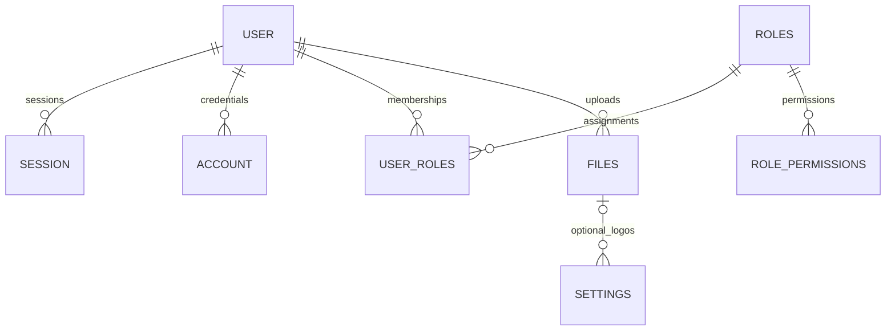

# شمای پایگاه داده و مهاجرت‌ها

[English](database-schema.md) · [فارسی](database-schema.fa.md)

شمای اجرایی [src/infrastructure/db/schema.ts](../src/infrastructure/db/schema.ts) است؛
مهاجرت SQL بازبینی‌شده و metadata مربوط به Drizzle در [drizzle/](../drizzle) قرار دارند.
یازده جدول، هویت، نشست قابل ابطال، مجوز، تنظیمات، تاریخ تقویم، چالش OTP و مشخصات فایل
را نگه می‌دارند. بایت فایل در storage محلی عمومی/خصوصی یا MinIO می‌ماند.

## نمایش و ستون‌ها

موجودیت مستقل شناسهٔ text دارد؛ شناسهٔ تولیدی برنامه از crypto.randomUUID() می‌آید.
عدد صحیح SQLite برای boolean و timestamp است و Drizzle آن را به boolean و Date
تبدیل می‌کند. palette قالب متن JSON دارد و جدول واسط کلید اصلی مرکب دارد.

| جدول             | ستون SQL (علامت ? یعنی nullable)                                                                                                                                               |
| ---------------- | ------------------------------------------------------------------------------------------------------------------------------------------------------------------------------ |
| user             | id, auth_email, email?, email_verified, mobile, username?, display_username?, first_name, last_name, name, image?, status, is_system_admin, created_at, updated_at             |
| session          | id, user_id, token, expires_at, ip_address?, user_agent?, created_at, updated_at                                                                                               |
| account          | id, user_id, provider_id, account_id, password?, access_token?, refresh_token?, id_token?, scope?, access_token_expires_at?, refresh_token_expires_at?, created_at, updated_at |
| verification     | id, identifier, value, expires_at, created_at?, updated_at?                                                                                                                    |
| roles            | id, name                                                                                                                                                                       |
| role_permissions | role_id, permission                                                                                                                                                            |
| user_roles       | user_id, role_id                                                                                                                                                               |
| files            | id, created_by, bucket, object_key, original_name, content_type, size, visibility, created_at                                                                                  |
| settings         | id, language_code, dark_theme, light_theme, dark_logo_id?, light_logo_id?                                                                                                      |
| otp_codes        | id, destination, purpose, subject?, value_hash, created_at, expires_at, consumed_at?                                                                                           |
| calendar_dates   | date                                                                                                                                                                           |

فیلد TypeScript یعنی user.email به auth_email در SQL نگاشت می‌شود؛ هویت داخلی و
الزامی Better Auth است. user.profileEmail به email در SQL نگاشت می‌شود؛ نشانی اختیاری
و تأییدشدهٔ پروفایل است. تأیید ایمیل فقط profileEmail را عوض می‌کند و auth_email یا
پرچم email_verified متعلق به provider را جایگزین نمی‌کند. در query، خروجی و migration
این ستون‌ها را یکی نگیرید.

patch پروفایل حساب و کاربر مدیریتی فقط بخش تغییرکردهٔ نام یا موبایل را تحویل
می‌دهد. ماندگاری، نام کامل را در همان UPDATE با پارامتر تحویل‌شده و ستون فعلی
دیتابیس می‌سازد. patch جزئی با snapshot قدیمی، حتی تغییر صرفاً موبایل، نباید
نام ترکیبی قدیمی را دوباره ذخیره کند.
حساب تازه یک ایمیل داخلی تصادفی و مستقل از شمارهٔ موبایل می‌گیرد. تغییر موبایل،
ایمیل داخلی ذخیره‌شده را حفظ می‌کند؛ از جمله مقدارهای قدیمی مشتق‌شده از موبایل
یا مقدارهای دلخواه. migration نیز این مقدارها را بازنویسی نمی‌کند. لایهٔ احراز
هویت باید کاربر را با موبایل پیدا کند و برای ورود از هویت ذخیره‌شده استفاده کند.
به این ترتیب حساب تازه می‌تواند از شمارهٔ آزادشده استفاده کند، بدون آنکه ایمیل
داخلی قدیمی را تصاحب کند. آداپتور احراز هویت با دیتابیس مصنوعی آزموده شده است؛
مسیر سرتاسری HTTP پیش از استقرار به بررسی جداگانه نیاز دارد. پیش از بازگشت
به نسخهٔ قدیمی، سازگاری rollback استقرار با هویت‌های احراز هویت و داده‌های
موجود را بررسی کنید.

اگر حساب پیش از ثبت پروفایل، نام کاربری یا ایمیل تأییدشده حذف شود، آداپتور
خطای نیاز به احراز هویت را برمی‌گرداند و سطر ناموجود را حساب موفق فرض نمی‌کند.

## رابطه‌ها و قیدها

- عضویت نقش کاربر و files.created_by ارجاع ورودی کسب‌وکار هستند و هر دو مانع حذف
  کاربر می‌شوند. سرویس حذف کاربر مصرف را در همان تراکنش حذف بررسی می‌کند و خطای
  معنایی برای رفع مصرف می‌دهد؛ نگاشت محلی‌سازی‌شدهٔ ۴۰۹ به HTTP آینده تعلق دارد. نوشتن جزئی یا قطع خودکار رابطه
  انجام نمی‌شود. foreign key در برابر انتساب هم‌زمان هم محافظت می‌کند.
- پس از حذف دائمی مجازِ کاربر بدون مصرف، session و account احراز هویت متعلق به او
  cascade می‌شوند. این‌ها پاک‌سازی فنی هویت حذف‌شده‌اند و مجوز حذف ارجاع کسب‌وکار
  نیستند. user_roles همچنان مانع حذف نقش تخصیص‌یافته است و حذف مجاز نقش فقط
  role_permissions متعلق به آن را cascade می‌کند.
- هر دو کلید خارجی لوگوی settings با RESTRICT جلوی حذف فایل استفاده‌شده را
  می‌گیرند. پیش از حذف فرادادهٔ فایل، ارجاع برند باید صریحاً حذف یا جایگزین شود؛
  قطع خودکار ارجاع مجاز نیست. عمومی‌بودن فایل لوگو با منطق برنامه و ماندگاری
  سنجیده می‌شود و foreign key آن را تضمین نمی‌کند. عملیات HTTP حذف فایل
  در این مرحله منتشر نشده است.
- auth_email، ایمیل پروفایل، mobile و username کاربر، token نشست، نام نقش و object_key
  فایل یکتا هستند. account روی (provider_id, account_id) قید یکتای مرکب دارد.
  user_roles و role_permissions کلید مرکب دارند.
- index برای session.user_id، account.user_id، verification.identifier و OTP روی
  (destination, purpose, subject) وجود دارد. subject در OTP اتصال کاربردی حساب است
  و foreign key ندارد؛ consumed_at مصرف یک‌باره و value_hash هش چالش را ثبت می‌کنند.
- settings با قرارداد برنامه از id=1 استفاده می‌کند؛ خود schema شناسهٔ دیگر را مجاز
  می‌داند. لوگوها اختیاری‌اند و می‌توانند یک فایل باشند. identifier تأیید و تاریخ
  تقویم رابطهٔ موجودیت تعریف‌شده ندارند.

## مرز migration و اعتبارسنجی

کارخانهٔ دیتابیس URL صریح تحویل‌شده را باز و client و دیتابیس Drizzle را برمی‌گرداند؛
بستن client با فراخواننده است. فقط برای URL فایل، پوشهٔ والد ایجاد می‌شود. تست
تنظیمات مصنوعی و فایل موقت متعلق به خودش یا دیتابیس درون‌حافظه‌ای را به کار
می‌برد. فعال بودن کلید خارجی برای اتصال محلی تازه و حفظ داده پس از بستن و
بازکردن دوباره سنجیده می‌شود. هیچ دیتابیس تولیدی فراخوانی نمی‌شود.

ترتیب SQL بررسی‌شده، نمایش ایمیل داخلی و پروفایل، اتصال subject در OTP، یکتایی
حساب ارائه‌دهنده، محدودسازی عضویت کاربر و ارجاع لوگو را ارتقا می‌دهد. SQL و
snapshot موجود تغییر نمی‌کنند؛ migration تازه، snapshot و رکورد journal متناظر
را اضافه می‌کند. migration لوگو جدول settings را با حفظ تمام سطرها و مقادیر زبان،
تم و لوگو بازسازی می‌کند. تست تأیید می‌کند اجراکنندهٔ migration پس از ارتقا
کلید خارجی را دوباره فعال کرده و یکپارچگی قیدها برقرار است.

تست واقعی ارتقای دیتابیس پرشده تمام سطرهای کاری و فنی را قبل و بعد مقایسه
می‌کند. حذف مستقیم هر یک از لوگوهای استفاده‌شده رد می‌شود؛ تراکنشی که زبان را
تغییر دهد و سپس حذف ممنوع را امتحان کند، کامل rollback می‌شود. تعیین تکلیف صریح
ارجاع برند، حذف قطعی را مجاز می‌کند. تست‌های دیگر، ارجاع عضویت و فایل، پاک‌سازی
فنی مجاز با cascade، نوشتن تراکنشی کاربر و نقش، یکتایی فراداده و نگاشت دسترسی
مرجع را بررسی می‌کنند. تشخیص cause حلقوی متوقف می‌شود؛ فقط کد ساختاریافتهٔ قید
SQLite یا پیام معتبر و سازگار با ابتدای مشخص، تعارض یکتایی را ثابت می‌کند.
متن query یا ورودی کاربر نمی‌تواند خطای نامرتبط دیتابیس را پنهان کند.

برای تمام بررسی‌های مرحله `npm run validate -- full` را اجرا کنید. LCOV واقعی
از تست همین checkout تولید می‌شود؛ نتیجهٔ SQLite محلی شاهد دیتابیس راه‌دور،
اجرای تولید، HTTP، ارسال OTP یا عملکرد کامل زمان اجرای احراز هویت نیست. آماده‌سازی
دیتابیس، seed اختیاری توسعه و ساخت مدیر اول منتشر شده‌اند؛ ابزار تولید Drizzle و
نقطهٔ ورود سرور هنوز منتشر نشده‌اند.
بدون مجوز صریح و backup هماهنگ و تأییدشده، migration را روی دادهٔ موجود اجرا نکنید.

[معماری](architecture.fa.md)، [بررسی مرحله](bootstrap.fa.md) و
[راهنمای مشارکت](../CONTRIBUTING.fa.md) را ببینید.
