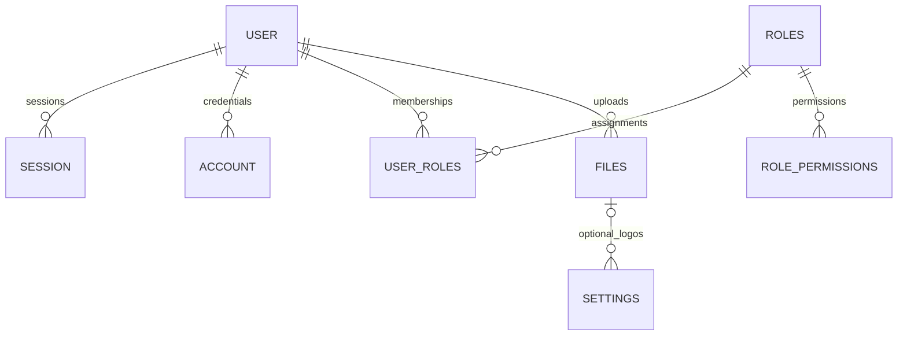

# Database schema and migrations

[English](database-schema.md) · [فارسی](database-schema.fa.md)

The executable schema is [src/infrastructure/db/schema.ts](../src/infrastructure/db/schema.ts);
reviewed SQL migrations and Drizzle metadata live in [drizzle/](../drizzle). The
eleven tables store identities, revocable sessions, authorization, settings, calendar
dates, OTP challenges and object metadata. File bytes stay in local public/private
storage or MinIO.

## Representation and columns

Independent entities use text IDs; generated application IDs use crypto.randomUUID().
SQLite integers represent booleans and timestamps, mapped by Drizzle to boolean and
Date. Theme palettes are JSON text. Join tables use composite primary keys.

| Table            | SQL columns (? means nullable)                                                                                                                                                 |
| ---------------- | ------------------------------------------------------------------------------------------------------------------------------------------------------------------------------ |
| user             | id, auth_email, email?, email_verified, mobile, username?, display_username?, first_name, last_name, name, image?, status, is_system_admin, created_at, updated_at             |
| session          | id, user_id, token, expires_at, ip_address?, user_agent?, created_at, updated_at                                                                                               |
| account          | id, user_id, provider_id, account_id, password?, access_token?, refresh_token?, id_token?, scope?, access_token_expires_at?, refresh_token_expires_at?, created_at, updated_at |
| verification     | id, identifier, value, expires_at, created_at?, updated_at?                                                                                                                    |
| roles            | id, name                                                                                                                                                                       |
| role_permissions | role_id, permission                                                                                                                                                            |
| user_roles       | user_id, role_id                                                                                                                                                               |
| files            | id, created_by, bucket, object_key, original_name, content_type, size, visibility, created_at                                                                                  |
| settings         | id, language_code, dark_theme, light_theme, dark_logo_id?, light_logo_id?                                                                                                      |
| otp_codes        | id, destination, purpose, subject?, value_hash, created_at, expires_at, consumed_at?                                                                                           |
| calendar_dates   | date                                                                                                                                                                           |

The TypeScript field user.email maps to SQL auth_email, the required internal
Better Auth identity. user.profileEmail maps to SQL email, the optional verified
profile address. Email verification changes profileEmail without replacing
auth_email or the provider's email_verified flag. Do not confuse these columns
in queries, exports or migrations.

Account and managed-user profile patches carry only changed name/mobile values.
Persistence composes the full name in the same SQL UPDATE using bound provided
parts and current database columns. Partial patches from stale actor snapshots,
including mobile-only updates, must not restore an old composed name.
New accounts receive an opaque random internal authentication email that is
independent of their mobile number. A mobile change preserves the stored email,
including legacy mobile-derived or custom values; migrations do not rewrite it.
The authentication layer must look up the user by mobile and use the stored
identity when signing in. A new account can therefore reuse a released mobile
without taking over a legacy internal email. Auth adapters are tested against synthetic
databases; end-to-end HTTP authentication requires separate verification before
rollout. Verify deployment rollback compatibility with existing authentication
identities and data before reverting to an older version.

If the account disappears before a profile, username or verified-email write,
the adapter reports the authentication-required error instead of succeeding or
mapping a missing database row as an account.

## Relationships and constraints

- User-role memberships and files.created_by are incoming business references:
  both restrict deletion of their user. The user-delete service checks those
  uses in the same transaction as deletion and raises a semantic conflict asking
  the caller to resolve them first, without partial writes or automatic unlinking.
  Foreign keys also protect against concurrent assignments.
- After an allowed hard deletion of an unused user, owned sessions and
  authentication accounts cascade. These technical records are cleanup of the
  deleted identity, not permission to remove business references. An assigned
  role remains protected by user_roles; an allowed role deletion cascades only
  to its owned role_permissions.
- Both settings logo foreign keys RESTRICT deletion of a referenced file. Resolve
  or reassign the branding references explicitly before deleting its metadata;
  no automatic unlinking is allowed. Public-file suitability is checked by
  application/persistence logic, not by the foreign key. There is no published
  file-delete HTTP operation.
- user auth_email, profile email, mobile and username; session token; role name;
  and file object_key are unique. account has a compound unique key on
  (provider_id, account_id). user_roles and role_permissions use composite keys.
- Indexes cover session.user_id, account.user_id, verification.identifier and
  OTP (destination, purpose, subject). OTP subject binds an application account
  without a foreign key; consumed_at records one-time use and value_hash stores
  the hash rather than a plaintext challenge.
- Settings use id=1 as an application singleton; the schema itself permits other
  IDs. Logo references are optional and may match. Verification identifiers and
  calendar dates have no declared entity relation.

## Migration and validation boundaries

The database factory opens the explicitly supplied URL and returns its client and
Drizzle database; the caller owns client closure. It creates a parent directory
only for file URLs. Tests pass synthetic configuration and use owned temporary
files or in-memory databases. They verify that foreign keys are enabled for each
new local connection and survive close/reopen. No production database is contacted.

The reviewed SQL sequence upgrades the internal/profile email representation,
OTP subject binding, provider-account uniqueness, restrictive user memberships
and restrictive logo references. Existing SQL and snapshots remain immutable;
new migrations append a matching snapshot and journal entry. The logo migration
rebuilds settings while preserving every row and its language, theme and logo
values. Tests verify foreign keys are enabled after the migration runner restores
them and that post-upgrade foreign-key integrity is clean.

Real populated-upgrade tests compare all business/technical table rows before
and after migration. Direct deletion of either referenced logo is rejected; a
transaction that changes language and then attempts forbidden deletion rolls
back completely. Explicitly resolving branding references permits hard deletion.
Other tests cover membership/file references, allowed technical cascade cleanup,
transactional user/role writes, metadata uniqueness and canonical permission maps.
Cause classification terminates on cycles; only structured SQLite constraint
codes or compatible anchored diagnostics establish a unique conflict. Query or
user payload text cannot mask unrelated database failures.

Run `npm run validate -- full` for the complete current-phase gate. Actual LCOV
comes from this checkout's tests; do not treat these local SQLite results as
remote database, production rollout, HTTP, OTP delivery or complete authentication
runtime evidence. Database initialization, optional development seeding, initial
administrator provisioning and the local server entry point are published;
Drizzle generation tooling is not. Do not run migrations on existing data without explicit
authorization and a verified matching backup.

See [architecture](architecture.md), [publication gate](bootstrap.md) and
[Contributing](../CONTRIBUTING.md).
